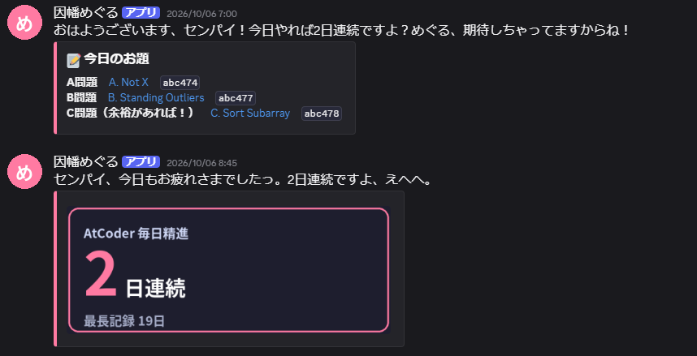
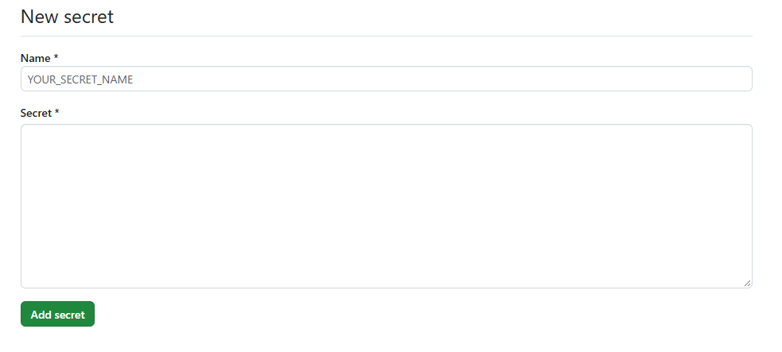
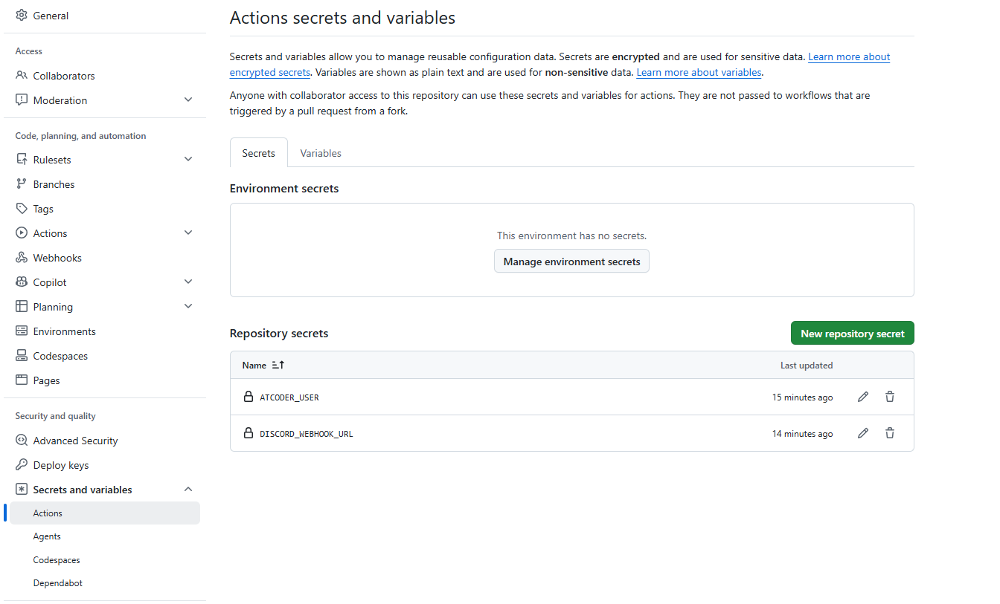
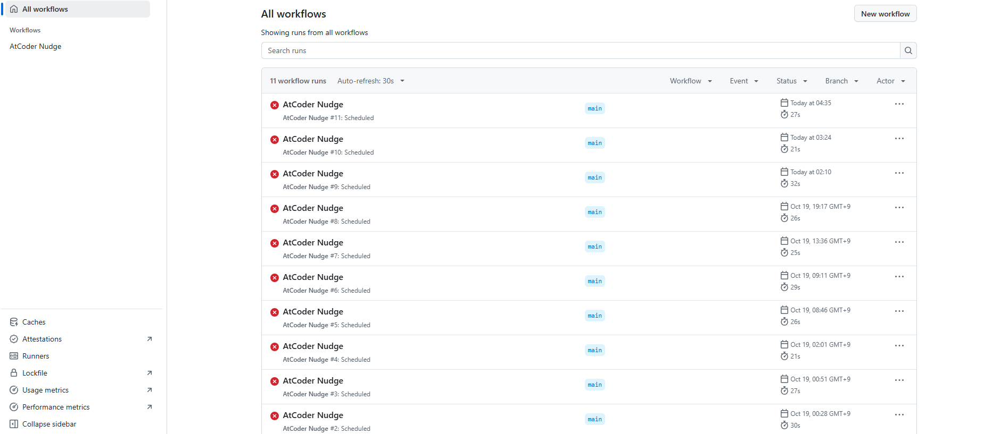

# atcoder-nudge

因幡めぐるが AtCoder の毎日精進を Discord で応援（と催促）してくれるスクリプトです。
アプリを開かなくても向こうから「今日のお題」が届き、解いたかどうかを自動で確認して、連続日数を数えてくれます。

> 「因幡めぐる」はゆずソフト『サノバウィッチ』の登場人物です。本リポジトリは非公式のファンメイドで、権利者とは関係ありません。キャラクター画像は同梱していません（後述）。元ネタは[関連リンク](#関連リンク)を参照してください。

## きっかけ

非公式なりきりアカウント [因幡めぐる@競技プログラミング（@meguru_comp）](https://twpf.jp/meguru_comp) を見て、「こんな感じで毎日応援してほしい！」と思って作りました。
このスクリプトはそのアイデアをお借りしています。

## 表示例



> 画像のセリフは作者が自分で追加したものです。同梱の `messages.txt` は各場面1行だけなので、好きなセリフを足してください（[カスタマイズ](#カスタマイズ)を参照）。
> Webhook のアイコンやカードに載せる画像も、各自で用意してください。


## できること

- **今日のお題**: 未ACの ABC の A / B / C 問題から、それぞれ一番新しいコンテストのものを毎朝出題します。
- **自動チェック**: [AtCoder Problems](https://kenkoooo.com/atcoder/) の API で提出を確認し、今日（JST）に1つでも AC があれば「今日やった」と判定します。
- **連続日数カード**: AC すると「○日連続」の画像カード付きで褒めてくれます。節目の日は専用の画像になります。
- **催促**: 夜になってもやっていなければ催促してきます。
- **記録は履歴から計算**: 連続日数・最長記録は毎回提出履歴から計算するので、マシンが止まって通知を逃しても記録はずれません。

## 1日の流れ

| タイマー | 時刻 | 内容 |
|---|---|---|
| `morning` | 7:00 | 今日のお題を投稿。昨日やっていなかったら一言添える |
| `check` | 7:15〜23:45（毎時15分・45分） | 今日 AC していて、まだ褒めていなければ褒める（1日1回） |
| `remind` | 21:00 | まだ AC していなければ催促 |
| `late` | 23:00 | まだなら強めに催促 |

節目の日: 3, 7, 14, 30, 50, 77日、100の倍数、365の倍数

## GitHub Actions で使う（おすすめ）

Raspberry Pi や自前サーバーを用意しなくても、GitHub Actions で定期実行できます。まずはこちらの方法がおすすめです。

### 1. リポジトリを Fork

このリポジトリ右上の **Fork** から、自分の GitHub アカウントにコピーします。通知設定や実行履歴は自分の Fork ごとに管理されます。

### 2. Actions Secrets を登録

Fork したリポジトリで次の順に開きます。

1. 上部タブの **Settings**
2. 左メニューの **Secrets and variables** → **Actions**
3. 緑の **New repository secret** ボタン

すると下のような「New secret」画面になります。**Name** 欄に Secret 名、**Secret** 欄に値を入れて **Add secret** を押します。



これを2回繰り返して、次の2つを登録します。

| Name 欄 | Secret 欄 |
|---|---|
| `ATCODER_USER` | 自分の AtCoder ユーザー名（例: `chokudai`） |
| `DISCORD_WEBHOOK_URL` | 通知先 Discord チャンネルの Webhook URL（`https://discord.com/api/webhooks/...`） |

登録すると「Repository secrets」の一覧に2つの名前が並びます（値は保存後は表示されません）。次のようになっていれば OK です。



Webhook URL は秘密情報です。コードや README に書いたり、ログに出力したりしないでください。

### 3. Actions を有効にして手動テスト

Fork したリポジトリでは、最初は Actions が止まっています。有効にしてから、1回手動で動かして Discord に届くか確認します。

#### 3-1. Actions を有効にする

1. Fork したリポジトリの上部タブで **Actions** を開く
2. 「Workflows aren't being run on this forked repository」という案内が出るので、緑の **I understand my workflows, go ahead and enable them** ボタンを押す

（このボタンが出ない場合は、すでに有効になっています。そのまま次へ進んでください。）

#### 3-2. 手動で1回動かす

1. Actions 画面の左側にある一覧から **AtCoder Nudge** をクリック
2. 右側に「This workflow has a workflow_dispatch event trigger.」と出るので、その横の **Run workflow** ボタンを押す
3. 小さなメニューが開くので、「実行する通知」で `morning` を選び、緑の **Run workflow** を押す

#### 3-3. 結果を確認する

少し待つと一覧に実行が追加されます（出てこないときはページを再読み込みしてください）。左側の「Workflows」の下にある **AtCoder Nudge** が、3-2 でクリックするワークフローです。



上の画像は、Secrets を登録する前に自動実行が始まり、すべて失敗している例です。

- **緑のチェック ✅** になり、Discord にメッセージが届いていれば成功です
- **赤いバツ ❌** になった場合は、その実行をクリック →「nudge」→ 赤くなっているステップを開くとエラー内容が見られます。多くは Secrets の名前の打ち間違い（`ATCODER_USER` / `DISCORD_WEBHOOK_URL`）か、Webhook URL のコピーミスです

`morning` 以外の `check` / `remind` / `late` は、条件（今日 AC 済みかどうか等）によっては何も送らずに成功で終わることがあります。動作確認には `morning` を使ってください。

### 4. 自動実行

通常は日本時間（JST）で次のスケジュールを目指します。

| モード | 時刻 |
|---|---|
| `morning` | 7:00 |
| `check` | 7:15〜23:45（毎時15分・45分） |
| `remind` | 21:00 |
| `late` | 23:00 |

GitHub Actions の cron は UTC 基準で、混雑時には開始が遅れることがあります。時刻ぴったりの実行が保証されるわけではありません。

API キャッシュと通知状態は Actions のキャッシュに保存し、実行ごとに新しい runner でも引き継げるようにしています。キャッシュは自分の Fork 内で管理されます。**`data/` や `config.json` をリポジトリにコミットしないでください。** `config.json` は Webhook URL を含むため、Git 管理外です。

画像は任意です。画像を追加しなくてもテキスト中心で動作します。

---

## ディレクトリ構成

```
atcoder-nudge/
├── nudge.py                 本体
├── messages.txt             セリフ集（最小構成。自由に追加してください）
├── config.example.json      設定ファイルのひな形
├── LICENSE                  MIT License
├── config.json              設定ファイル（自分で作る・git管理外）
├── images/
│   ├── normal/              普段のカード用画像（自分で置く・git管理外）
│   └── milestone/           節目の日用画像（自分で置く・git管理外。空なら normal を使う）
├── fonts/                   日本語フォントを置いてもよい（任意・git管理外）
├── systemd/                 systemd のユニットファイル
└── data/                    自動生成（APIキャッシュ・state.json。git管理外）
```

## 必要なもの

- Python 3.9 以上
- Python パッケージ: `requests`, `pillow`（Windows の場合は `tzdata` も）
- 日本語フォント（カード画像の文字用）
- Discord の Webhook URL
- 定期実行の仕組み（Linux なら systemd。cron などでも可）

## Discord の準備

1. 通知用のテキストチャンネルを作る
2. チャンネルの「編集」→「連携サービス」→「ウェブフック」→「新しいウェブフック」
3. 名前を「因幡めぐる」にし、好きなアイコン画像を設定する
4. 「ウェブフックURLをコピー」でURLを取得する

> ⚠️ Webhook URL を知っている人は誰でもそのチャンネルに投稿できます。人に見せたり、リポジトリにコミットしたりしないでください。漏れた場合は Webhook を削除して作り直してください。

## 設定ファイル

`config.example.json` をコピーして `config.json` を作ります。

```json
{
  "atcoder_user": "your_atcoder_id",
  "webhook_url": "https://discord.com/api/webhooks/XXXXXXXX/YYYYYYYY",
  "font_path": ""
}
```

| 項目 | 内容 |
|---|---|
| `atcoder_user` | AtCoder のユーザー名 |
| `webhook_url` | Discord の Webhook URL |
| `font_path` | 日本語フォントのパス。空なら `fonts/` と Linux の標準的な場所を自動で探す |

`font_path` の例:

- Windows: `C:/Windows/Fonts/meiryob.ttc`（`\` ではなく `/` で書く）
- Mac: `/System/Library/Fonts/ヒラギノ角ゴシック W6.ttc`
- Linux: 空でよい（`fonts-noto-cjk` などを入れておけば自動で見つかる）

指定したパスが存在しない場合は自動検索に切り替わります。

## 画像を用意する

`images/normal/` と `images/milestone/` に png / jpg / webp を置くと、カードの左側に表示されます（複数あればランダム）。
画像がなくてもカードは文字だけで作られます。

公式素材などの権利物を使う場合は、[ゆずソフトの著作権に関するガイドライン](https://www.yuzu-soft.com/new/copy.html)に従い、個人の範囲で利用してください。**リポジトリには含めないでください**（`.gitignore` 済み）。

## 手元で試す

```bash
git clone https://github.com/Kyo1r0/atcoder-nudge-pub.git atcoder-nudge
cd atcoder-nudge
python3 -m venv .venv
source .venv/bin/activate          # Windows (PowerShell): .venv\Scripts\Activate.ps1
pip install requests pillow        # Windows は tzdata も
cp config.example.json config.json # Windows: Copy-Item config.example.json config.json
# config.json の atcoder_user と webhook_url を書き換える
```

Windows で `Activate.ps1` が「スクリプトの実行が無効」で止まる場合は、一度だけ `Set-ExecutionPolicy -Scope CurrentUser RemoteSigned` を実行してください。

軽いものから順に試します。

```bash
python nudge.py --test-card 30      # カード画像だけ作る → data/preview.png を開いて確認
python nudge.py morning --dry-run   # API から実データを取り、送信せずに内容を表示
python nudge.py remind --dry-run    # 今日まだ AC していなければ催促文が表示される
python nudge.py morning             # 実際に Discord へ送信
```

`--dry-run` を付けると Discord には送らず、内容を画面に表示します（画像は `data/preview.png` に保存）。

褒めるメッセージを試すときは、何か1問 AC して10分ほど待ってから `python nudge.py check --dry-run` を実行します（AtCoder Problems への反映待ちがあるため）。

## 自前環境で動かす（任意：Raspberry Pi / Linux + systemd）

以下は `~/atcoder-nudge` に clone して、その中に `.venv` を作る前提です。別の場所に置く場合は読み替えてください。

### 1. コードと venv を用意する

```bash
cd ~
git clone https://github.com/Kyo1r0/atcoder-nudge-pub.git atcoder-nudge
cd atcoder-nudge
python3 -m venv .venv
.venv/bin/pip install requests pillow
cp config.example.json config.json   # 中身を書き換える
chmod 600 config.json
```

画像を使う場合は `images/normal/` などに置きます（手元の PC から `scp` で送るなど）。

### 2. 日本語フォントを確認する

```bash
fc-list :lang=ja | head -1
```

何も表示されなければ `sudo apt install fonts-noto-cjk`（Debian / Ubuntu 系の場合）などで入れます。`fonts/` に `.ttf` / `.otf` を1つ置くだけでも構いません。

### 3. 手動で動作確認

```bash
.venv/bin/python nudge.py --test-card 30
.venv/bin/python nudge.py morning --dry-run
```

### 4. systemd に登録

まずタイムゾーンが日本になっているか確認します（タイマーの時刻はシステムのタイムゾーン基準です）。

```bash
timedatectl | grep "Time zone"      # Asia/Tokyo であること
# 違う場合: sudo timedatectl set-timezone Asia/Tokyo
```

`systemd/atcoder-nudge@.service` の `User=` / `WorkingDirectory=` / `ExecStart=` はプレースホルダー（`YOUR_USER`）になっています。
リポジトリのディレクトリで次を実行すると、**今いる場所と自分のユーザー名に置き換えて** インストールできます。

```bash
sed -e "s|/home/YOUR_USER/atcoder-nudge|$PWD|g" -e "s|YOUR_USER|$USER|g" \
  systemd/atcoder-nudge@.service | sudo tee /etc/systemd/system/atcoder-nudge@.service
sudo cp systemd/atcoder-nudge-*.timer /etc/systemd/system/
sudo systemctl daemon-reload
sudo systemctl enable --now \
  atcoder-nudge-morning.timer \
  atcoder-nudge-check.timer \
  atcoder-nudge-remind.timer \
  atcoder-nudge-late.timer
```

手で編集したい場合は、ファイル内のコメントに従って3行を書き換えてから `/etc/systemd/system/` にコピーしてください。

登録できたか確認します。

```bash
systemctl list-timers 'atcoder-nudge*'
cat /etc/systemd/system/atcoder-nudge@.service   # パスが正しく置き換わっているか
```

タイマーを待たずに、すぐ1回動かしたいときは次のようにします。

```bash
sudo systemctl start atcoder-nudge@morning.service
```

### systemd の構成について

常駐するボット（`Type=simple` + `Restart=always`）とは違い、このスクリプトは「決まった時刻に1回動いて終わる」ものです。そのため、次の2種類のファイルを組み合わせています。

- **`atcoder-nudge@.service`**: 「何を実行するか」を書いたサービス。`Type=oneshot` で、1回実行したら終了します。
- **`atcoder-nudge-*.timer`**: 「いつ実行するか」を書いたタイマー。時刻になると対応するサービスを起動します。

サービス名の `@` は **テンプレートユニット** の印です。`atcoder-nudge@morning.service` として起動すると、ファイル内の `%i` が `morning` に置き換わり、`nudge.py morning` が実行されます。サービスファイル1つで4種類のモードをまかなえるのはこのためです。

サービスはタイマーから起動されるので、サービス側には `[Install]` を書いておらず、`enable` するのもタイマーだけです。

### cron を使う場合

systemd を使わない環境では、`crontab -e` で次のように書いても同じ動きになります（パスは自分の環境に合わせてください。`CRON_TZ` に対応していない cron ではシステムのタイムゾーンが使われます）。

```
CRON_TZ=Asia/Tokyo
0 7 * * *        cd ~/atcoder-nudge && .venv/bin/python nudge.py morning
15,45 7-23 * * * cd ~/atcoder-nudge && .venv/bin/python nudge.py check
0 21 * * *       cd ~/atcoder-nudge && .venv/bin/python nudge.py remind
0 23 * * *       cd ~/atcoder-nudge && .venv/bin/python nudge.py late
```

## ログの確認（systemd）

```bash
journalctl -u 'atcoder-nudge@*' -n 50          # 直近50行
journalctl -u 'atcoder-nudge@*' --since today  # 今日の分
journalctl -u atcoder-nudge@morning -f         # morning をリアルタイムで追う
```

## 更新するとき

```bash
cd ~/atcoder-nudge
git pull
# systemd/ を変更した場合のみ、上の「systemd に登録」の sed / cp をやり直して
sudo systemctl daemon-reload
```

## カスタマイズ

- **セリフ**: `messages.txt` は各場面1行だけの最小構成です。`[セクション]` の下に1行追加するだけで、ランダムに1つ選ばれるようになります。`{days}`（現在の連続日数）、`{next}`（今日やった場合の日数）、`{best}`（最長記録）が使えます。改行したいときは `\n` と書きます。
- **画像**: `images/normal/`、`images/milestone/` に置くだけ。
- **節目の日**: `nudge.py` の `is_milestone()` を編集します。
- **時刻**: `systemd/*.timer` の `OnCalendar=` を編集し、コピーし直して `daemon-reload` します。

| セクション | 使われる場面 |
|---|---|
| `morning` | 朝のお題 |
| `remind` | 21時の催促 |
| `late` | 23時の催促 |
| `done` | 普段の日に AC したとき |
| `milestone` | 節目の日に AC したとき |
| `restart` | 記録が途切れたあとの1日目 |
| `broken` | 朝、昨日やっていなかったとき |

## トラブルシューティング

| 症状 | 原因と対処 |
|---|---|
| Actions が ❌ で `Set ATCODER_USER and DISCORD_WEBHOOK_URL in Settings > Secrets and variables > Actions.` と出る | Secrets が登録されていないか、名前が違う。「2. Actions Secrets を登録」をやり直す |
| 提出が0件扱いになる | ユーザー名を確認。`atcoder_user` を小文字にして試す |
| AC したのに褒められない | AtCoder Problems への反映待ち（数分〜十数分）。次の `check` を待つ |
| 22時台に AC したのに23時に催促された | 同上。反映が間に合わなかった |
| カードの日本語が □ になる | 日本語フォントが見つかっていない。`font_path` を指定するか、フォントを入れる |
| タイマーの時刻がずれる | システムのタイムゾーンが `Asia/Tokyo` になっているか確認 |
| `status=203/EXEC` で失敗する | `ExecStart=` のパスが違う。`YOUR_USER` が残っていないか確認 |
| `PermissionError` が出る | `User=` のユーザーがリポジトリのディレクトリに書き込めるか確認（`data/` を作るため） |

## 注意

- `config.json`（Webhook URL）は git 管理外にしています。コミットしないでください。
- AtCoder Problems の API には負荷をかけないよう、提出は差分取得、問題一覧は1日1回のキャッシュにしています。実行間隔を極端に短くしないでください。

## ライセンス

コード（`nudge.py` や systemd のユニットファイルなど）は [MIT License](LICENSE) です。自由に使ったり改変したりして構いません。

ただし「因幡めぐる」というキャラクターの権利はゆずソフトにあり、このライセンスの対象外です。キャラクター画像などを使う場合は、上記の著作権ガイドラインに従ってください。

## 謝辞

提出履歴・問題一覧・難易度のデータは、kenkoooo さんが運営する [AtCoder Problems](https://kenkoooo.com/atcoder/) の [API](https://github.com/kenkoooo/AtCoderProblems/blob/master/doc/api.md) を利用させていただいています。AtCoder 公式には提出履歴を取得できる API がないため、このスクリプトは AtCoder Problems があって初めて動きます。素晴らしいサービスの運営に感謝します。

API は個人の善意で運営されているので、実行間隔を極端に短くするなど、負荷をかける使い方はしないでください。

## 関連リンク

- [サノバウィッチ 公式サイト（ゆずソフト）](https://www.yuzu-soft.com/new/product/sothewitch/) — 原作。※成人向けサイトのため18歳未満は閲覧できません
- [因幡めぐる - ピクシブ百科事典](https://dic.pixiv.net/a/%E5%9B%A0%E5%B9%A1%E3%82%81%E3%81%90%E3%82%8B) — キャラクターの紹介
- [因幡めぐる@競技プログラミング（@meguru_comp）](https://twpf.jp/meguru_comp) — このスクリプトを作るきっかけになった、めぐるが競プロをやる非公式なりきりアカウント
